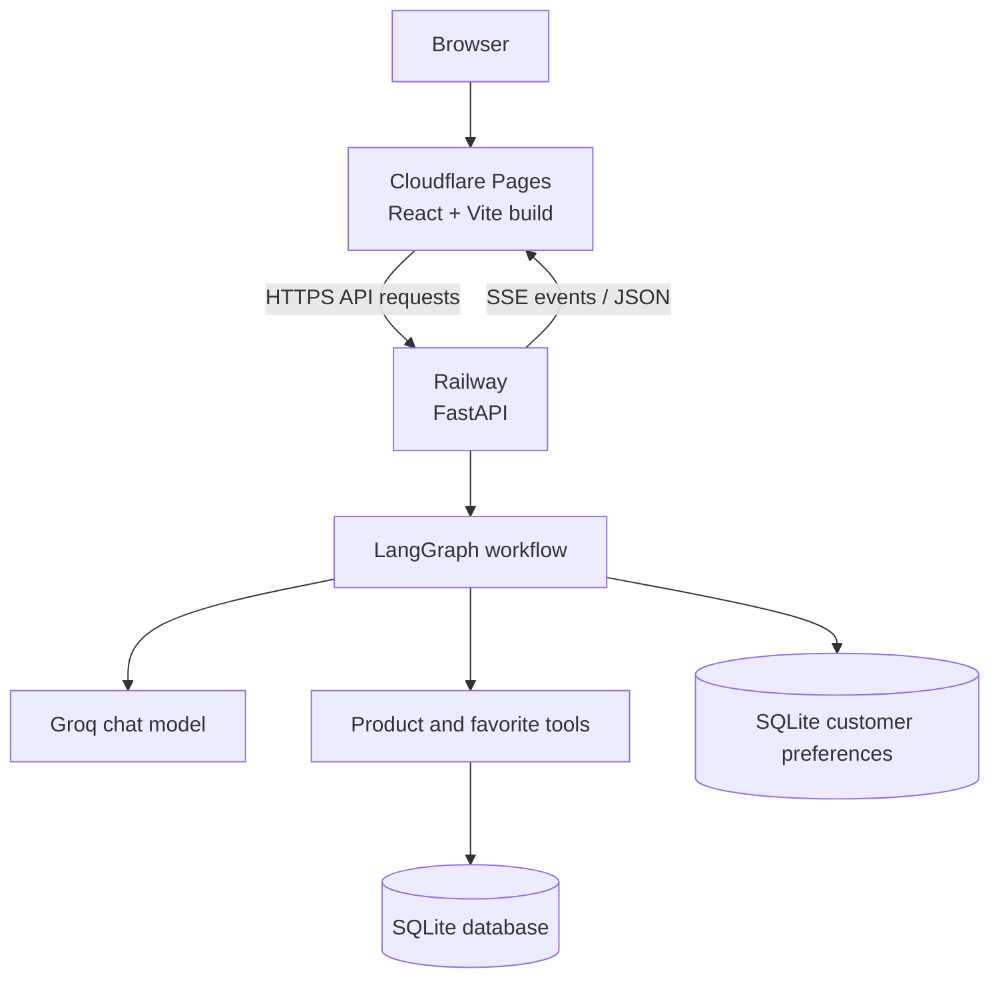

# Blink AI — Agentic Shopping Assistant

Blink AI is a full-stack shopping assistant that uses an LLM-powered LangGraph workflow and database-backed tools to help customers search for products, inspect individual products, compare alternatives, and manage favorites. It also captures selected reusable shopping preferences and associates them with authenticated users.

The application includes a React/TypeScript frontend, a FastAPI backend, SQLite persistence, Groq-hosted model inference, Docker-based local deployment, and a public deployment split between Railway (backend) and Cloudflare Pages (frontend).

> **Project status:** The developer reports that the public frontend, backend integration, login, chat, and streaming execution display are working. The evaluation section below preserves the distinction between earlier passing runs and a later regression run that exposed one product-detail tool-routing failure.

## Key features

- Product search by category, with optional maximum-price, organic-only, and sorting filters.
- Product detail lookup by product name.
- Product comparison using product and review data.
- Add, retrieve, and remove user-specific favorites.
- Preference extraction for `budget`, `category`, `sort_by`, and `product_preference`.
- SQLite preference persistence and user-scoped retrieval.
- Email/password registration and login, password hashing, and JWT bearer authentication.
- A synchronous chat endpoint and a Server-Sent Events (SSE) streaming endpoint.
- Frontend execution trace display for graph, LLM, and tool events.
- Dockerfiles for backend and frontend, plus Docker Compose for local full-stack operation.

## Architecture at a glance



The frontend uses `VITE_API_BASE_URL` to select the API origin. For local Vite development, it can remain unset so the Vite `/api` proxy is used. In production, set it to the Railway service URL. The FastAPI CORS allowlist is controlled by `FRONTEND_ORIGINS`.

## Technology stack

| Layer | Technology |
|---|---|
| Frontend | React 19, TypeScript, Vite 8, React Router, Tailwind CSS 4 |
| API | FastAPI, Pydantic, Uvicorn |
| Agent orchestration | LangChain, LangGraph |
| Model provider | Groq, configured with `openai/gpt-oss-20b` |
| Database | SQLite |
| Authentication | `pwdlib` password hashing, PyJWT, bearer tokens |
| Observability | Application logging, timing spans, streamed execution events; LangSmith evaluation experiment |
| Packaging | UV lockfile, Docker, Docker Compose, Nginx |
| Hosting | Railway backend, Cloudflare Pages frontend |

## Repository layout

```text
.
├── app/
│   ├── main.py                 # FastAPI routes and SSE stream
│   ├── graph_agent.py          # LangGraph workflow, memory and routing
│   ├── llm.py                  # Groq model configuration
│   ├── logging_config.py       # Application logging and trace helpers
│   ├── database/               # SQLite connection, users, favorites, memory
│   ├── services/               # Authentication service layer
│   ├── tools/                  # Product and favorite tools
│   └── test/                   # Automated tests
├── Database/
│   ├── store.db                # Synthetic/demo SQLite database
│   └── database_setup.py       # Database setup script
├── evals/
│   ├── datasets/               # Golden evaluation cases (JSONL)
│   └── ...                     # Evaluation and experiment scripts
├── frontend/
│   ├── src/components/         # Product, comparison, activity and auth UI
│   ├── src/pages/              # Chat, login and registration pages
│   └── src/services/           # API and SSE client functions
├── Dockerfile                  # Backend image
├── docker-compose.yml          # Local full-stack orchestration
├── pyproject.toml
├── uv.lock
└── README.md
```

## Run locally

### Prerequisites

- Python 3.14 or newer
- UV (the project was developed with UV 0.9.18)
- Node.js 22 and npm
- Docker Desktop / Docker Engine (for containerized execution)
- A Groq API key

### 1. Configure backend environment

Create a root `.env` file. Do not commit it.

```dotenv
GROQ_API_KEY=replace_with_your_groq_api_key
JWT_SECRET_KEY=replace_with_a_long_random_secret
FRONTEND_ORIGINS=http://localhost:5173,http://127.0.0.1:5173
```

Generate a JWT secret locally, for example:

```powershell
python -c "import secrets; print(secrets.token_urlsafe(48))"
```

### 2. Install and run the backend

From the repository root:

```powershell
uv sync
uv run uvicorn app.main:app --reload --host 0.0.0.0 --port 8000
```

Backend health check: `http://localhost:8000/api/health`.

### 3. Run the frontend in development mode

Open another terminal:

```powershell
cd frontend
npm ci
npm run dev
```

The Vite development proxy forwards `/api` requests to `http://127.0.0.1:8000`. Keep `VITE_API_BASE_URL` unset for this local proxy workflow unless you intentionally want to call a different API origin.

### 4. Run the complete application with Docker Compose

From the repository root, ensure `.env` exists, then run:

```powershell
docker compose up --build -d
docker compose ps
docker compose logs --tail=100 backend frontend
```

Open `http://localhost:8080`.

Stop the services without deleting named volumes:

```powershell
docker compose down
```

Avoid `docker compose down -v` unless you explicitly intend to delete the persistent local volumes.

## Evaluation summary

The evaluation report is maintained in [`docs/evaluation-report.md`](docs/evaluation-report.md). At a high level, reported evidence includes:

- PS-001 organic honey search passed in a standalone run.
- A later four-case agent run passed PS-002, PS-003, PC-001, and PD-001; the user clarified that this run collected four cases, not five.
- Six memory tests passed.
- An earlier combined run reported 10/10 passing (four agent cases plus six memory tests, 17.25 seconds).
- A later regression run reported 10 passed and 1 failed. The failure was PD-001: the model selected `search_product_tool` where `check_product_tool` was expected.
- A LangSmith experiment named `blink-ai-agent-eval-v1-cb83c2` reported five runs and average displayed applicable scores of 1.00 for tool-selection, tool-argument, and product-result evaluators. `not_applicable` scores were reported for cases where an evaluator did not apply.
- The frontend smoke-test checklist was reported as 8/8 passed.

These are results from separate runs and experiments; they must not be combined into a single 100% pass-rate claim.

## Deployment overview

- **Backend:** Railway, built from the backend Dockerfile. Set `GROQ_API_KEY`, `JWT_SECRET_KEY`, and `FRONTEND_ORIGINS` in the Railway service variables.
- **Frontend:** Cloudflare Pages, connected to the Git repository. Set the root directory to `frontend`, build command to `npm run build`, output directory to `dist`, and set `VITE_API_BASE_URL` to the Railway backend URL as a Pages build variable.
- **CORS:** Set `FRONTEND_ORIGINS` to the exact Cloudflare Pages origin, without a trailing slash. Include local origins only when needed.

The public Railway backend health endpoint used during deployment was:

`https://agentic-shopping-assistant-production-9086b3bd.up.railway.app/api/health`

The project's Cloudflare Pages domain should be copied from the Cloudflare dashboard and recorded in the deployment notes; it was not present in the inspected project archive.

**Persistence warning:** Docker Compose uses named volumes for the local SQLite database and logs. A production Railway volume must be attached and mounted at the path expected by the application (`/app/Database`) before relying on durable user data across redeployments. The uploaded archive and conversation do not establish that Railway volume persistence has been configured and verified.

## Known limitations and next improvements

1. **Inconsistent detail-tool selection:** The latest reported regression run had PD-001 fail because the model selected `search_product_tool` instead of `check_product_tool`. Keep this as an explicit regression case and improve tool-routing instructions or tool descriptions in a future iteration.
2. **Preference intent classification:** Preference extraction should continue to be evaluated for distinguishing durable preferences from one-off search constraints.
3. **In-memory graph checkpointer:** The graph uses `InMemorySaver` for checkpointing. This is not durable across process restarts. Customer preferences are separately stored in SQLite; do not confuse preference persistence with durable conversation checkpoint history.
4. **SQLite deployment scale:** SQLite is appropriate for this learning/demo application and its current scope. Reassess the database choice and concurrency strategy before serving substantial production traffic.
5. **Operational persistence:** Verify Railway volume attachment, backup, and restore procedures before treating hosted user data as durable.
6. **Orders table scope:** The sample database includes an `orders` table, but the current system prompt explicitly says the assistant cannot add items to carts, place orders, or make purchases. Do not present checkout/order placement as an implemented feature.

## Security notes

- Never commit `.env`, `frontend/.env`, API keys, or JWT secrets.
- Keep provider credentials in Railway service variables or a local untracked `.env` file.
- Use a unique strong `JWT_SECRET_KEY` in production.
- User passwords are hashed using `pwdlib`'s recommended `PasswordHash` implementation.
- Authenticated API calls use a bearer token; the API checks token validity and verifies that the user account still exists and is active.
- Review the synthetic SQLite sample data before public distribution. Ensure its accounts and preference records are genuinely synthetic and contain no reused credentials or personal data.

## License

Add a license file before presenting this repository as an openly licensed project. No license was confirmed in the inspected archive.
