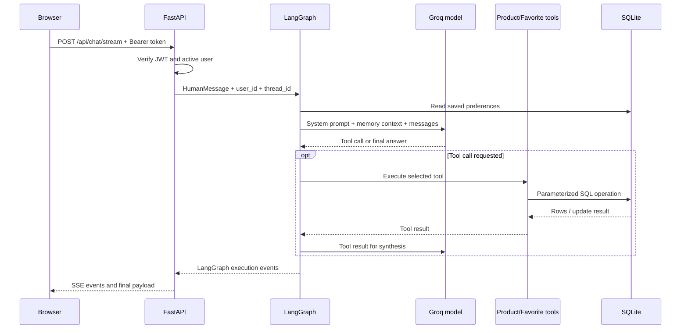

# Architecture and Data Flow

## System boundary

The application has four main runtime responsibilities:

1. **React client:** presents login, registration, chat, product cards, comparison output, and agent activity/execution traces.
2. **FastAPI API:** validates requests, authenticates users, invokes the LangGraph workflow, and returns JSON or SSE events.
3. **LangGraph agent:** coordinates preference capture, LLM reasoning, tool calls, tool-result handling, and bounded tool execution.
4. **SQLite:** stores the product catalog, reviews, user accounts, favorites, and reusable customer preferences.

## Request flow

## LangGraph workflow

The source defines a `StateGraph` over `MessagesState` with these nodes:

- `capture_preferences`: requires a configured `user_id`, examines the latest human message, and asks the structured-output preference extractor for reusable preferences.
- `llm`: loads the authenticated user's stored preferences, prepares memory context, invokes the Groq chat model with bound tools, and returns the model response.
- `tools`: a LangGraph `ToolNode` containing the six product and favorites tools.
- `tool_limit`: creates a user-facing stop message when the current turn exceeds the configured tool-call threshold.

The graph starts at `capture_preferences`, proceeds to `llm`, conditionally routes to `tools` or ends, and routes to `tool_limit` when the tool-call threshold is exceeded. Tool results return to the LLM node for synthesis.

### Tool-call safeguards

- `MAX_TOOL_CALLS_PER_TURN` is configured as **5**.
- The FastAPI invocation config sets `recursion_limit` to **20**.
- `ValueError` tool errors are converted into a correction request.
- SQLite errors are converted into a generic temporary database-unavailable message.
- Other exceptions are re-raised by the tool error handler.

## Memory and identity

The API verifies a bearer JWT before chat and favorite-related operations. It passes both `user_id` and a user-scoped `thread_id` (`{user_id}:{conversation_id}`) into LangGraph.

Preference extraction supports four keys:

- `budget`
- `category`
- `sort_by`
- `product_preference`

The extraction prompt explicitly instructs the model to capture reusable preferences, not temporary shopping requests. Preferences are upserted in SQLite under the composite identity `(user_id, preference_key)` and read for later requests. A latest explicit request takes priority over stored context. An explicit request for all/every product can temporarily disable a saved organic-only preference when the request itself does not say organic.

The graph checkpointer is `InMemorySaver`. This is in-process checkpoint state and is not equivalent to durable long-term memory. Durable customer preferences are stored separately in SQLite.

## Frontend and streaming

The frontend's `chat.ts` client reads the bearer token from local storage, posts to `/api/chat/stream`, reads the response body incrementally, and parses SSE frames. It forwards recognized events to callbacks and returns only after receiving a final event.

The event set includes:

- `request_start`
- `graph_start`
- `llm_start`
- `llm_end`
- `tool_call`
- `tool_start`
- `tool_end`
- `final`
- `error`

Nginx forwards `/api/` requests to the backend service and disables proxy buffering for streaming responses.

## Deployment topology

The reported public deployment separates frontend and backend:

- Cloudflare Pages hosts the Vite production build.
- Railway hosts the FastAPI container.
- The frontend receives the backend origin via `VITE_API_BASE_URL` at build time.
- FastAPI allows the Pages origin through `FRONTEND_ORIGINS`.

For local Docker Compose, the frontend container exposes port 8080 and Nginx forwards API traffic to the `backend` service on port 8000. The backend uses named volumes for `/app/Database` and `/app/app/logs`.
